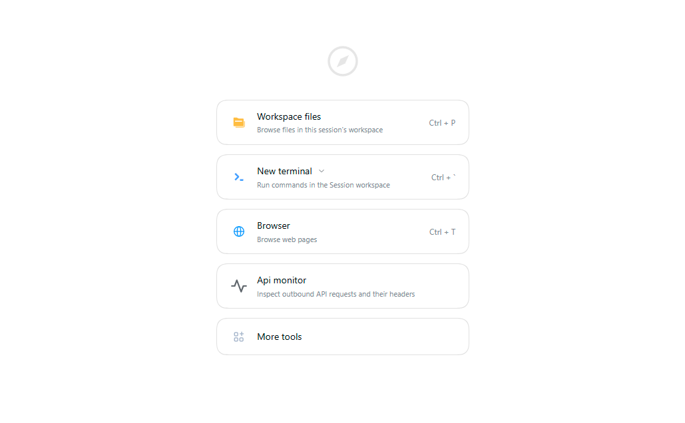
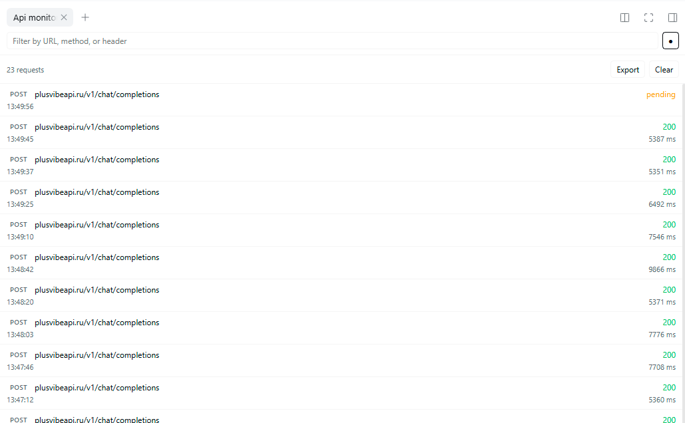
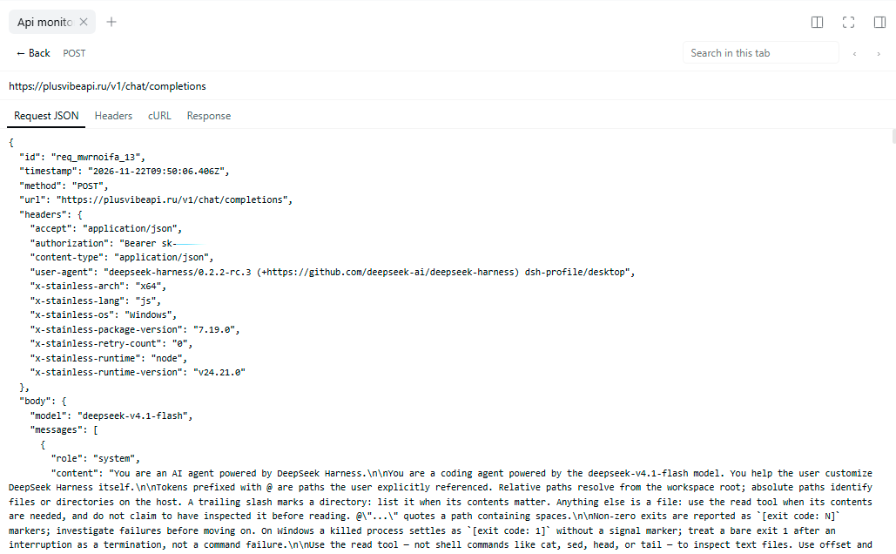

# Api monitor for [DSH]

**English** · [Русский](README.ru.md)

A [DSH] plugin that shows every outbound API request the Host makes — the URL, the method, **all** headers, the raw JSON body and the response — in a tab of the right sidebar.

The Models and session pages tell you *that* a request happened. This plugin shows you exactly *what* went over the wire, including the `Authorization` header and the full prompt payload that provider-side views leave out.

> Requires a Web-GUI deployment of [DSH] (Desktop app or `dsh web`). Plain ESM, no build step, no dependencies.

| Start page card | Request list | Request JSON |
| --- | --- | --- |
|  |  |  |

## Where it appears

- **Right sidebar → Start page**: an **Api monitor** card, placed after *Browser*. Click it to open the monitor as a tab in the same panel.
- **Left sidebar, bottom**: a pulse button next to Settings. It opens the same tab from anywhere.

The tab is a master/detail inspector:

| Tab | Shows |
| --- | --- |
| **Request JSON** | The whole exchange as one document: URL, method, headers, body, response, error |
| **Headers** | Request and response headers as tables |
| **cURL** | A ready-to-run command that reproduces the call |
| **Response** | The **assembled answer**, with the raw stream one click away |

Above the detail pane: live filter, pause, export to `.json`, and clear.

### Reading a streamed answer

A streaming provider answers with hundreds of small SSE frames, which is unusable raw. The Host folds those frames back into the answer the model actually produced, so the **Response** tab opens on readable text:

- the deltas are concatenated in order, including Anthropic's typed events and Gemini's `candidates` shape;
- *reasoning* text is kept apart and collapsed under **Reasoning**;
- tool calls are merged from their fragments and listed under **tool calls**;
- the header line shows status, duration, model, `finish` reason, token usage and how many frames were folded;
- **Raw stream** switches to the original frames, and **Assembled** switches back.

### Search

Every tab has the same search box: type to highlight all matches in yellow, `Enter` / `Shift+Enter` (or the ‹ › buttons) to step through them, `Esc` to clear. The box counts hits as `3/17` and scrolls the current one into view. The search covers what the tab shows — the request JSON, both header tables, the cURL command, the assembled answer and its reasoning (and the raw stream when that view is active).

## Install

Straight from the repository — no build step, no dependencies, so pnpm never asks to run install scripts:

```sh
dsh plugin add github:avego/dsh-api-monitor
```

On a profile other than the default, name it: `dsh plugin --profile <profile> add github:avego/dsh-api-monitor`, then restart that host.

Or from a local checkout:

```sh
git clone https://github.com/avego/dsh-api-monitor.git
```

- **UI**: Settings (gear at the sidebar foot) → **Plugins** → **Add plugin** → pick the cloned folder;
- **or an agent**: `plugin_manager` with `action: install_bundle` and `target` set to the absolute path.

Requirements: a deployment that serves the Web GUI (the Desktop app or `dsh web`) — the Host half needs the `webServer` service. Headless and SDK profiles have no Web server and no sidebar, so there is nowhere for this plugin to run.

Changes apply to the whole profile and survive restarts.

## What gets captured

The Host half instruments two entry points of the process:

1. `globalThis.fetch` — what every HTTP SDK in the tree goes through (OpenAI-, Anthropic- and Gemini-compatible clients, `fetch`-based providers);
2. `node:http` / `node:https` `request` — code paths that build requests by hand.

Each call becomes one record. A record is written when the request starts and updated when the response headers arrive and again when the preview is read, so a request still in flight is visible as `pending`.

A record looks like this (trimmed, token redacted):

```json
{
  "id": "req_mwrn3x1k_2",
  "timestamp": "2026-11-22T08:25:41.045Z",
  "host": "plusvibeapi.ru",
  "url": "https://plusvibeapi.ru/v1/chat/completions",
  "method": "POST",
  "headers": {
    "accept": "application/json",
    "authorization": "Bearer sk-…",
    "content-type": "application/json",
    "user-agent": "deepseek-harness/0.2.2-rc.3",
    "x-stainless-arch": "x64",
    "x-stainless-lang": "js",
    "x-stainless-runtime": "node"
  },
  "body": {
    "model": "deepseek-v4.1-flash",
    "messages": [
      { "role": "system", "content": "You are an AI agent powered by [DSH]…" },
      { "role": "user", "content": "проведи анализ проекта" }
    ]
  },
  "durationMs": 4688,
  "pending": false,
  "responseStatus": 200,
  "responseStatusText": "OK",
  "responseHeaders": { "content-type": "text/event-stream; charset=utf-8" },
  "responsePreview": { "…": "first 64 KiB of the response" },
  "responseBytes": ">=65700",
  "error": null
}
```

### Record fields

| Field | Meaning |
| --- | --- |
| `id` | `req_<base36 time>_<sequence>` |
| `timestamp` | ISO 8601, when the call was made |
| `host` | Host name of the URL, for grouping |
| `url` | Full URL, query string included |
| `method` | Upper-case HTTP method |
| `headers` | Request headers: lower-cased names, one string per value |
| `body` | Parsed JSON when the body is JSON, raw text otherwise, `null` when empty |
| `durationMs` | Time until the response headers arrived |
| `pending` | `true` while the call is still in flight |
| `responseStatus` … `responseStatusText` | Response status |
| `responseHeaders` | Response headers, same shape as `headers` |
| `responsePreview` | The beginning of the raw response, up to 256 KiB, parsed as JSON when it is JSON |
| `responsePreviewTruncated` | `true` when the raw preview was cut at that limit |
| `responseBytes` | How many bytes of the response were read |
| `responseIncomplete` | `true` when the read stopped at the capture ceiling, so the answer may be cut short |
| `responseAssembled` | The streamed answer folded into text: `kind`, `text`, `reasoning`, `model`, `finishReason`, `usage`, `toolCalls`, `frames`, `done`, `incomplete` |
| `error` | Transport failure, or the connection closing before a response |

Bodies are parsed rather than stored as strings, so the detail view and the export keep the original JSON structure. A body larger than 8 MiB is stored as `{ "truncated": true, "characters": N, "preview": "…" }`.

## HTTP routes

The Client half reads the buffer over three routes on the same Web server that serves the GUI, so you can also script against them:

| Route | Method | Answer |
| --- | --- | --- |
| `/api/api-monitor/requests` | `GET` | `{ ok, count, requests: [...] }`, newest first |
| `/api/api-monitor/requests` | `POST`, `DELETE` | Clears the buffer, `{ ok: true }` |
| `/api/api-monitor/clear` | `POST` | Clears the buffer, `{ ok: true }` |
| `/api/api-monitor/events` | `GET` | `text/event-stream`: `init`, `new-request`, `update-request`, `cleared` |

```sh
curl -s http://127.0.0.1:<port>/api/api-monitor/requests | jq '.requests[0].headers'
```

These routes live outside the Remote gateway, so they carry no session token of their own. They therefore answer **loopback requests only** (`127.0.0.0/8`, `::1`, `::ffff:127.*`) and refuse everything else with `403`. Any local process can still read them — see [Security](#security).

## Configuration

The bundle's `cordis.patch.yml` carries the defaults:

```yaml
- insert:
    - id: api-monitor
      name: dsh-api-monitor
      config:
        maxEntries: 200          # default 100, capped at 2000
        maxTotalChars: 67108864  # default 48 MiB, capped at 512 MiB
```

- `maxEntries` — how many requests stay in the buffer.
- `maxTotalChars` — the shared budget for stored bodies and previews. When it is exceeded, the oldest records are dropped, so a few huge prompts cannot balloon the process.

Editing the bundle's own file works for a trial, but `git pull` may overwrite it. To keep a value, override the same `api-monitor` row in your **profile's** patch layer instead — that layer is yours and survives upgrades.

## How it works

**Host half** (`index.js`) wraps `globalThis.fetch` and the `node:http`/`node:https` `request` entry points, normalizes each call into a record, and keeps a bounded in-memory ring buffer. The wrappers are transparent: the request is forwarded unchanged, the original response object is returned to the caller, and a response body is only read through `Response.clone()`, bounded and then cancelled. Failing to capture never fails the call. Assembly happens here too, at read time, so the Client receives finished text instead of frames.

**Client half** (`client.js`) is a browser module that registers a right-sidebar tab type (`api-monitor`) with a guide card, the tab body, the tab title, and one rail button at the sidebar foot. It loads the buffer over the routes above and follows new calls over SSE, with a 2.5 s poll as a fallback. It renders with the host theme tokens, keeps its copy in its own locale namespace (English and Russian), and unregisters everything on unload.

## Limitations

- **Host process only.** It instruments the DSH Host, not the machine: traffic from bash, terminals and other subprocesses is not visible. Use a real proxy for that.
- **Call-time `fetch` only.** A library that captured `fetch` before the plugin loaded (`const f = globalThis.fetch` at import time) keeps bypassing the hook.
- **Not every client.** Code that skips both hooks — `undici.request()`, native HTTP/2 sessions, raw sockets, `node-fetch`'s internal paths — is invisible.
- **Streamed request bodies** are not read: draining a `ReadableStream` would consume the caller's body.
- **Assembly covers the common shapes.** Chat-completion chunks ([OI]), Gemini `candidates`, Anthropic typed events and the Responses events are folded; an unusual provider stream still shows its raw frames, and its text may stay empty.
- **The raw preview is 256 KiB**, and the assembled answer is read up to 4 MiB of stream. Past that the record is marked `responseIncomplete`, the answer stops where the capture stopped, and the UI says so.
- **Memory only.** Nothing is written to disk, and a restart starts empty.
- **The `Api monitor` card sits after `Browser`**, not below *More tools*: the sidebar always renders the *More* block last, and card order cannot move it.

## Security

Captured records contain secrets. The `authorization` header holds your API key in clear, and the body holds the entire prompt — code, credentials, anything you typed.

- Nothing is sent anywhere; the plugin has no telemetry and no outbound calls of its own.
- The routes answer loopback only and are not otherwise authenticated, which means **any local process** can read the buffer while DSH runs.
- **Export writes secrets to disk.** Keep exported files out of repositories, issue trackers and screenshots.
- Run **Clear** when you are done, and treat the buffer as a credential store, not a log.

## Development

No build, no bundler, no dependencies — edit the files and reload.

```sh
node --check index.js
node --check client.js
```

To load a change: toggle the plugin row in **Plugins** off and on (this loads a fresh module generation), or restart DSH. A Client-half change also needs the page reloaded.

## Files

| File | Role |
| --- | --- |
| `package.json` | Bundle manifest: `dsh.bundle.patch`, `dsh.client` (`platform: web`, slot prerequisites) |
| `cordis.patch.yml` | The Loader patch that inserts the plugin row and its config |
| `index.js` | Host half: interception, buffer, routes |
| `client.js` | Client half: tab type, tab body, tab title, rail button, copy |
| `locale/en.json`, `locale/ru.json` | Plugin Manager title, description and detail document |
| `docs/DETAIL.md` | The detail page shown in Plugin Manager (English and Russian) |
| `icon.svg` | Plugin icon, used inside DSH |
| `icon.png` | 180×180 raster icon for the plugin catalog storefront |
| `contrib/` | The entry and instructions for listing this plugin in the community catalog |
| `LICENSE` | MIT license text |

## License

[MIT](LICENSE) © 2026 [Alexander Tishov](https://avego.org)

You may use, modify and redistribute this plugin, including commercially, as long as the copyright notice and the permission notice stay with it. The software comes with no warranty.
